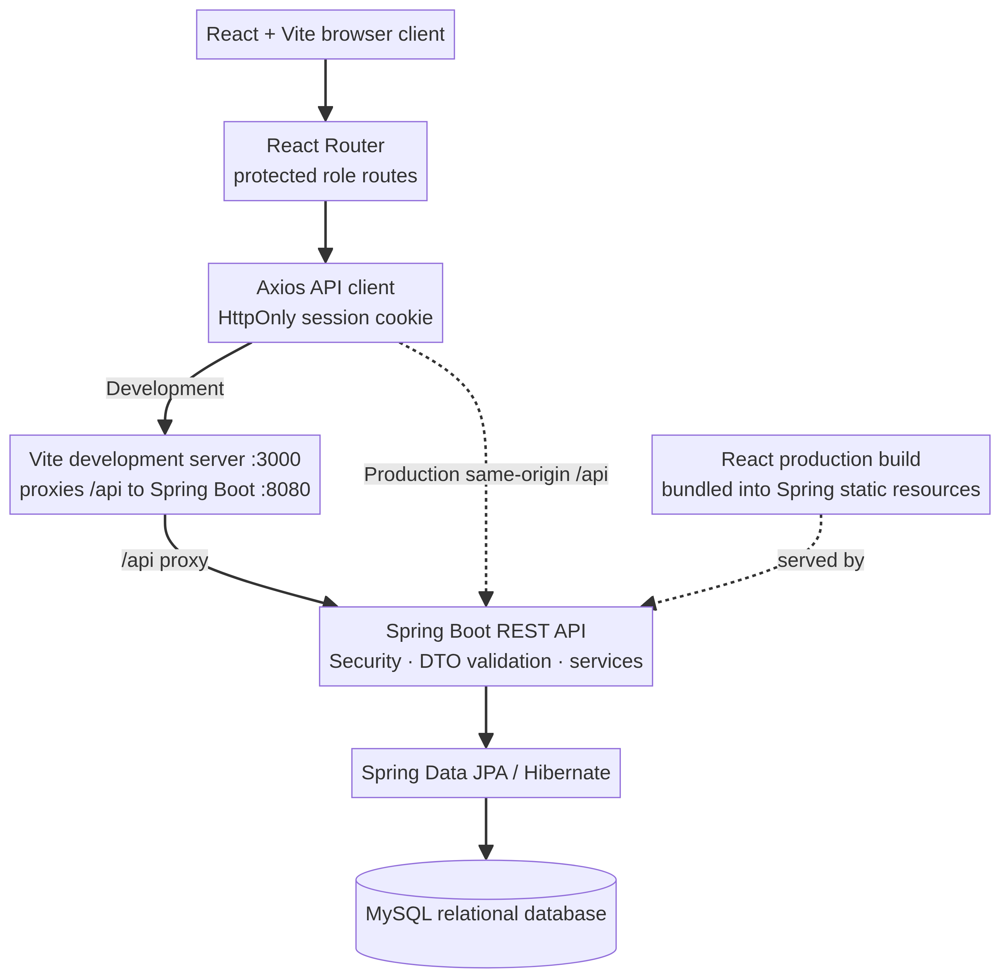

# TaskFlow architecture

The Vite development server proxies the React client's relative `/api` requests to the Spring Boot API. In the production container, the React build is included in the Spring Boot static resources, so the same-origin API and SPA share one listener. Spring Security validates the opaque HttpOnly session cookie and role; service methods scope employee data and calculate statistics from persisted MySQL records. JPA/Hibernate maps the employee-to-task and employee-to-session relationships.

The source diagram is [`architecture.mmd`](architecture.mmd).