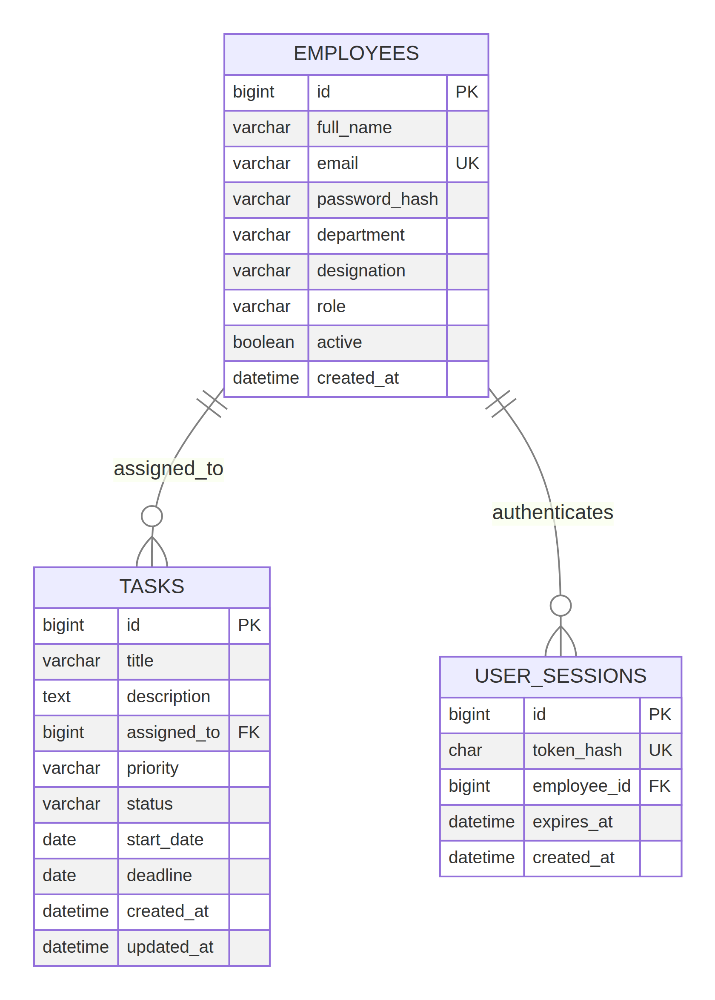

# TaskFlow relational model

An employee can have zero or more tasks, while each task has one active assignment reference. Employee accounts can have several time-limited login sessions; only a SHA-256 token hash is persisted. Employee deactivation preserves task history.

The source diagram is [`er-diagram.mmd`](er-diagram.mmd); the SQL reference is [`database/schema.sql`](../database/schema.sql).